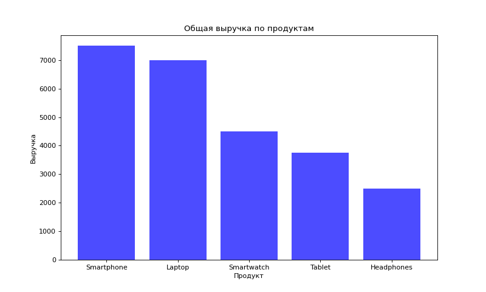
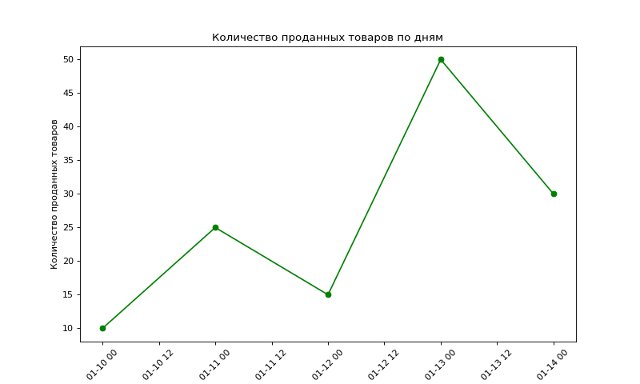
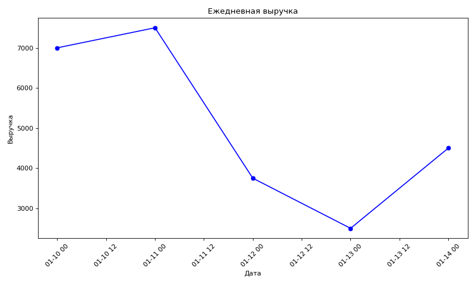
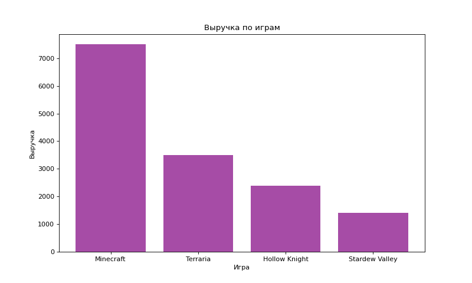
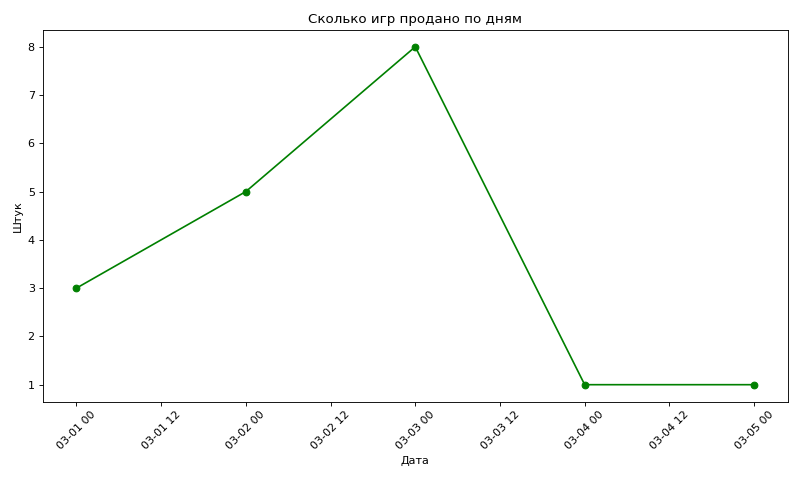

# Закрепление занятия 7: циклы, запросы и графики

Здесь всё, с чем работали на занятии 7: цикл и цикл внутри цикла, вопросы к базе из Python (шаги 5–7 урока 9) и графики matplotlib (шаги 8–10). Потом ошибки, которые случались на занятии, и задачи с проверкой.

Объяснения спрятаны под строками «Подробнее»: открывай, если что-то непонятно.

## 0. Что нужно дома

1. **PostgreSQL, psycopg2 и база `sales_data` с продажами**, как на прошлом занятии: всё описано в [закреплении занятия 6](../session6/practice.html), раздел «0. Что нужно дома».
2. **matplotlib**, библиотека для графиков. Один раз, в терминале VS Code:

   ```bash
   python -m pip install matplotlib
   ```

   Проверка: `python -c "import matplotlib; print(matplotlib.__version__)"` печатает номер версии, например `3.10.9`.

Запускай программы в терминале VS Code: `python имя_файла.py`.

## 1. Цикл: шаг за шагом

Цикл `for` повторяет одни и те же строки для каждого элемента списка. В шаге 4 так записывались продажи: `for sale in sales_data:`. На каждом круге в переменной `sale` лежит одна продажа, и строки под `for`, сдвинутые вправо, выполняются для неё.

Посмотреть это по шагам, с кодом, переменной `sale` и таблицей в базе: **[интерактив «Цикл for sale in sales_data»](loop-sale.html)**. Нажимай «Дальше» и следи, что лежит в `sale` на каждом круге и что уходит в базу.

То же самое можно увидеть без базы. Запусти:

```python
sales_data = [
    ("Laptop", 10, 700),
    ("Smartphone", 25, 300),
    ("Tablet", 15, 250),
]

for sale in sales_data:
    print("в sale лежит:", sale)
    print("выручка этой продажи:", sale[1] * sale[2])

print("цикл закончился")
```

```
в sale лежит: ('Laptop', 10, 700)
выручка этой продажи: 7000
в sale лежит: ('Smartphone', 25, 300)
выручка этой продажи: 7500
в sale лежит: ('Tablet', 15, 250)
выручка этой продажи: 3750
цикл закончился
```

- В списке три продажи, значит три круга. На каждом круге выполнились оба `print`, сдвинутые вправо.
- `sale[1]` это второе значение продажи (штуки), `sale[2]` третье (цена): счёт в Python идёт с нуля.
- `print("цикл закончился")` не сдвинут, он не внутри цикла и выполнился один раз, после всех кругов.

## 2. Цикл внутри цикла

С этого начинали занятие: олимпиадная задача «Вложенный цикл».

```
S := 0
нц для i от 1 до 2
    нц для j от 2 до 3
        S := S + i + j
    кц
кц
```

Внешний цикл делает шаги: i = 1, потом i = 2. Внутри каждого шага внутренний цикл делает свои подшаги: j = 2, потом j = 3. **Пока не выполнятся все подшаги, следующий шаг не наступает:** сначала i = 1 с j = 2 и j = 3, и только потом i = 2, снова с j = 2 и j = 3.

Пройти это по шагам, с подсветкой строк, на школьном языке и на Python: **[интерактив «Вложенный цикл»](https://timkiberone8-eng.github.io/olymp/tasks/nested-loop.html)**.

На Python та же задача. `range(1, 3)` даёт 1 и 2: правое число в `range` не входит, поэтому оно на единицу больше, чем «до» в условии. `print(i, j, S)` печатает строку после каждого прибавления:

```python
S = 0
for i in range(1, 3):
    for j in range(2, 4):
        S = S + i + j
        print(i, j, S)
print("S =", S)
```

```
1 2 3
1 3 7
2 2 11
2 3 16
S = 16
```

Четыре строки: внутренний цикл прошёл свои два подшага на **каждом** из двух шагов внешнего, 2 × 2 = 4. S не обнулялась при смене i: `S = 0` стоит до циклов, один раз.

<details markdown="1">
<summary markdown="span">Проверь себя: сколько раз выполнится print</summary>

```python
for i in range(1, 4):
    for j in range(1, 6):
        print(i, j)
```

Сначала посчитай в уме, потом запусти.

**Ответ:** 15 раз. Внешний цикл делает 3 шага (i = 1, 2, 3), внутри каждого внутренний делает 5 подшагов (j = 1, 2, 3, 4, 5): 3 × 5 = 15.

</details>

Ещё строки проверки к этой задаче (другие границы циклов, а одна такая, что без программы не посчитать) на [странице олимпиады занятия 7](olympiad.html).

## 3. Вопросы к базе: шаги 5–7

Все три программы устроены одинаково: подключиться к `sales_data`, отправить запрос, забрать ответ `fetchall()` и напечатать его циклом. Меняется только запрос.

**Шаг 5, выручка по каждому продукту,** подробно разобран в [закреплении занятия 6](../session6/practice.html), раздел «Спросить у базы»: что делает каждая строка `SELECT ... GROUP BY ... ORDER BY`.

### Шаг 6. Сколько штук продано по дням

```python
import psycopg2

connection = psycopg2.connect(
    database="sales_data",
    user="postgres",
    password="postgres",
    host="127.0.0.1",
    port="5432"
)
cursor = connection.cursor()

cursor.execute("""
SELECT sale_date, SUM(quantity) AS total_quantity
FROM sales
GROUP BY sale_date
ORDER BY sale_date
""")
daily_sales_data = cursor.fetchall()
for row in daily_sales_data:
    print(f"Дата: {row[0]}, Продано: {row[1]}")

cursor.close()
connection.close()
```

```
Дата: 2024-01-10, Продано: 10
Дата: 2024-01-11, Продано: 25
Дата: 2024-01-12, Продано: 15
Дата: 2024-01-13, Продано: 50
Дата: 2024-01-14, Продано: 30
```

Отличие от шага 5 в двух местах. Группы теперь по дате (`GROUP BY sale_date`): все продажи одного дня в одной группе. Складываем штуки (`SUM(quantity)`), а не деньги. Сортировка по дате, от ранней к поздней, поэтому без `DESC`.

<details markdown="1">
<summary markdown="span">Подробнее: что лежит в daily_sales_data</summary>

`fetchall()` вернул список, в нём по кортежу на каждую строку ответа:

```
[(datetime.date(2024, 1, 10), 10), (datetime.date(2024, 1, 11), 25), ...]
```

`row[0]` это дата, `row[1]` число штук. Цикл `for row in daily_sales_data:` устроен как `for sale in sales_data:` из раздела 1: на каждом круге в `row` одна строка ответа.

</details>

### Шаг 7. Выручка за каждый день

Это задание «попробуй сам»: на слайде кода нет. Подсказка: возьми программу шага 6 и поменяй в запросе, что складывать. Выручка одной продажи это штуки, умноженные на цену, как в шаге 5.

**Проверь себя:** 5 строк, первая 10 января 7000, самая большая выручка 11 января, 7500.

<details markdown="1">
<summary markdown="span">Показать ответ</summary>

```python
import psycopg2

connection = psycopg2.connect(
    database="sales_data",
    user="postgres",
    password="postgres",
    host="127.0.0.1",
    port="5432"
)
cursor = connection.cursor()

cursor.execute("""
SELECT sale_date, SUM(quantity * price) AS total_revenue
FROM sales
GROUP BY sale_date
ORDER BY sale_date
""")
daily_revenue_data = cursor.fetchall()
for row in daily_revenue_data:
    print(f"Дата: {row[0]}, Выручка: {row[1]}")

cursor.close()
connection.close()
```

```
Дата: 2024-01-10, Выручка: 7000
Дата: 2024-01-11, Выручка: 7500
Дата: 2024-01-12, Выручка: 3750
Дата: 2024-01-13, Выручка: 2500
Дата: 2024-01-14, Выручка: 4500
```

От шага 6 отличается одно: `SUM(quantity * price)` вместо `SUM(quantity)`. Имя `daily_revenue_data` взято со слайда 19: из переменной с таким именем там строится график шага 10.

</details>

## 4. Графики: шаги 8–10

Каждый график строится в два этапа: сначала забрать ответ у базы (запрос из шагов 5–7), потом нарисовать его. `plt.show()` открывает окно с графиком, и программа ждёт, пока ты его не закроешь: пока окно открыто, терминал занят.

### Шаг 8. Выручка по продуктам столбиками

```python
import psycopg2
import matplotlib.pyplot as plt

connection = psycopg2.connect(
    database="sales_data",
    user="postgres",
    password="postgres",
    host="127.0.0.1",
    port="5432"
)
cursor = connection.cursor()

# запрос из шага 5
cursor.execute("""
SELECT product_name, SUM(quantity * price) AS total_revenue
FROM sales
GROUP BY product_name
ORDER BY total_revenue DESC
""")
revenue_data = cursor.fetchall()

# данные уже у нас, подключение больше не нужно
cursor.close()
connection.close()

# два списка: подписи столбиков и их высоты
products = [row[0] for row in revenue_data]
revenue = [row[1] for row in revenue_data]

plt.figure(figsize=(10, 6))
plt.bar(products, revenue, color='blue', alpha=0.7)
plt.title("Общая выручка по продуктам")
plt.xlabel("Продукт")
plt.ylabel("Выручка")
plt.show()
```



| Строка | Что делает |
|---|---|
| `import matplotlib.pyplot as plt` | подключить библиотеку графиков и дальше звать её коротким именем `plt` |
| `products = [row[0] for row in revenue_data]` | из каждой строки ответа взять первое значение (продукт) и собрать их в список |
| `revenue = [row[1] for row in revenue_data]` | то же со вторым значением (выручка) |
| `plt.figure(figsize=(10, 6))` | новое окно для графика, ширина 10 и высота 6 |
| `plt.bar(products, revenue, ...)` | столбики: подписи из `products`, высоты из `revenue`; `alpha=0.7` делает их чуть прозрачными |
| `plt.title(...)` | заголовок над графиком |
| `plt.xlabel(...)` | подпись горизонтальной оси, X |
| `plt.ylabel(...)` | подпись вертикальной оси, Y |
| `plt.show()` | показать окно |

<details markdown="1">
<summary markdown="span">Подробнее: что значит [row[0] for row in revenue_data]</summary>

Это короткая запись цикла, который собирает список. Длинная запись делает то же самое:

```python
products = []
for row in revenue_data:
    products.append(row[0])
```

На каждом круге в `row` одна строка ответа, например `('Smartphone', Decimal('7500'))`, и `row[0]` из неё дописывается в конец списка `products`.

</details>

### Шаг 9. Сколько штук продано по дням, линией

Данные из шага 6. Вместо столбиков линия с точками: так лучше видно, как число меняется день за днём.

```python
import psycopg2
import matplotlib.pyplot as plt

connection = psycopg2.connect(
    database="sales_data",
    user="postgres",
    password="postgres",
    host="127.0.0.1",
    port="5432"
)
cursor = connection.cursor()

# запрос из шага 6
cursor.execute("""
SELECT sale_date, SUM(quantity) AS total_quantity
FROM sales
GROUP BY sale_date
ORDER BY sale_date
""")
daily_sales_data = cursor.fetchall()

cursor.close()
connection.close()

dates = [row[0] for row in daily_sales_data]
quantities = [row[1] for row in daily_sales_data]

plt.figure(figsize=(10, 6))
plt.plot(dates, quantities, marker='o', color='green')
plt.title("Количество проданных товаров по дням")
plt.xlabel("Дата")
plt.ylabel("Количество проданных товаров")
plt.xticks(rotation=45)
plt.show()
```



- `plt.plot` рисует линию, `marker='o'` ставит кружок в каждую точку.
- `plt.xticks(rotation=45)` поворачивает подписи дат, чтобы они не наезжали друг на друга.
- Подписи под осью вида `01-10 00` и `01-10 12` это месяц-день и час: matplotlib ставит деления каждые 12 часов, а точки стоят на 00.
- Подпись «Дата» под осью в окне может не поместиться: повёрнутые даты выталкивают её за нижний край. Это лечит строка `plt.tight_layout()` перед `plt.show()`, она есть в шаге 10.

### Шаг 10. Выручка за каждый день

Это шаг 9, только данные из шага 7.

```python
import psycopg2
import matplotlib.pyplot as plt

connection = psycopg2.connect(
    database="sales_data",
    user="postgres",
    password="postgres",
    host="127.0.0.1",
    port="5432"
)
cursor = connection.cursor()

# запрос из шага 7
cursor.execute("""
SELECT sale_date, SUM(quantity * price) AS total_revenue
FROM sales
GROUP BY sale_date
ORDER BY sale_date
""")
daily_revenue_data = cursor.fetchall()

cursor.close()
connection.close()

dates = [row[0] for row in daily_revenue_data]
revenues = [row[1] for row in daily_revenue_data]

plt.figure(figsize=(10, 6))
plt.plot(dates, revenues, marker='o', color='blue')
plt.title("Ежедневная выручка")
plt.xlabel("Дата")
plt.ylabel("Выручка")
plt.xticks(rotation=45)
plt.tight_layout()
plt.show()
```



Сравни с шагом 9: больше всего **штук** продали 13 января (50 наушников), а больше всего **денег** принесло 11 января (смартфоны дороже). Разные вопросы, разные запросы, разные графики.

## 5. Найди ошибку

Такие ошибки были на занятии. Сначала подумай, что не так, потом открывай ответ.

**Ошибка 1.** Программа шага 8, а в конце:

```python
plt.title("Общая выручка по продуктам")
plt.xlabel("Продукт")
plt.xlabel("Выручка")
plt.show()
```

Ошибки Python нет, график рисуется. Но под осью X написано «Выручка», а у оси Y подписи нет.

<details markdown="1">
<summary markdown="span">Показать ответ</summary>

Два раза `xlabel`, и второй перезаписал первый: «Продукт» заменилось на «Выручка». Для вертикальной оси нужен `ylabel`. Запомнить: X лежит, Y стоит.

Python о такой ошибке не предупредит: обе строки правильные, просто делают не то, что задумано. Поэтому график после запуска надо **прочитать**: совпадают ли подписи с тем, что на осях.

</details>

**Ошибка 2.** Программа шага 9 с заголовком «Количество проданных товаров по дням», но запрос в ней из шага 5:

```python
cursor.execute("""
SELECT product_name, SUM(quantity * price) AS total_revenue
FROM sales
GROUP BY product_name
ORDER BY total_revenue DESC
""")
```

Ошибки нет, линия рисуется. Что не так?

<details markdown="1">
<summary markdown="span">Показать ответ</summary>

Под осью стоят названия продуктов, а не даты, и высота точек это выручка, а не штуки. Заголовок говорит одно, а данные другие. График рисует то, что вернул запрос, а заголовок и подписи просто текст, их никто не проверяет.

Нужен запрос шага 6: `SELECT sale_date, SUM(quantity) ... GROUP BY sale_date ORDER BY sale_date`. Сначала проверь запрос отдельно, печатью, как в шаге 6, и только потом рисуй.

</details>

**Ошибка 3.**

```python
import matplotlib.pyplot as plt

pit.figure(figsize=(10, 6))
```

```
NameError: name 'pit' is not defined. Did you mean: 'plt'?
```

<details markdown="1">
<summary markdown="span">Показать ответ</summary>

`pit` вместо `plt`: буквы похожи. Имя `plt` появилось в строке `import matplotlib.pyplot as plt`, а `pit` Python нигде не встречал. Он даже подсказывает: `Did you mean: 'plt'?`, «может, ты имел в виду plt?». Если в ошибке `NameError`, сравни имя в ошибке с тем, как оно написано там, где его создали.

</details>

**Ошибка 4.**

```python
cursor = connection.cursor()
cursor.execute
SELECT sale_date, SUM(quantity) AS total_quantity
FROM sales
GROUP BY sale_date
ORDER BY sale_date
```

```
    SELECT sale_date, SUM(quantity) AS total_quantity
           ^^^^^^^^^
SyntaxError: invalid syntax
```

<details markdown="1">
<summary markdown="span">Показать ответ</summary>

Запрос SQL стоит в программе как есть, без кавычек и скобок. Python читает его как свой код, а такого кода в Python нет. Запрос это текст для базы: он передаётся в `execute` строкой в скобках, а несколько строк берутся в тройные кавычки:

```python
cursor.execute("""
SELECT sale_date, SUM(quantity) AS total_quantity
FROM sales
GROUP BY sale_date
ORDER BY sale_date
""")
```

Важно: при `SyntaxError` Python не выполняет **ни одной** строки файла, даже тех, что выше ошибки. Он сначала читает файл целиком, и если прочитать не смог, не запускает ничего. Поэтому, если такой кусок дописан в файл шага 4, перестаёт работать и сам шаг 4. Новый шаг пиши в новом файле.

</details>

**Ошибка 5.** Запрос шага 6, только во второй строке:

```python
FROM sales_data
```

```
psycopg2.errors.UndefinedTable: ОШИБКА:  отношение "sales_data" не существует
LINE 3: FROM sales_data
             ^
```

<details markdown="1">
<summary markdown="span">Показать ответ</summary>

`sales_data` это имя **базы**, а таблица в ней называется `sales`. После `FROM` пишут таблицу. Базу выбирают один раз, при подключении: `database="sales_data"`.

Путаницу добавляет то, что в шаге 4 список продаж в Python тоже назван `sales_data`. Это третье, Python-имя, и к базе оно отношения не имеет.

</details>

**Ошибка 6.**

```python
plt.xlabel[("Продукт")]
```

```
TypeError: 'function' object is not subscriptable
```

<details markdown="1">
<summary markdown="span">Показать ответ</summary>

Квадратные скобки вместо круглых. `xlabel` это функция, её **вызывают** круглыми скобками: `plt.xlabel("Продукт")`. Квадратные скобки берут элемент из списка или кортежа, как `row[0]`, а у функции элементов нет: «функцию нельзя индексировать».

</details>

**Ошибка 7.** В конце программы шага 8 стоят только строки графика, а строк со списками нет:

```python
cursor.close()
connection.close()

plt.figure(figsize=(10, 6))
plt.bar(products, revenue, color='blue', alpha=0.7)
```

```
NameError: name 'products' is not defined
```

<details markdown="1">
<summary markdown="span">Показать ответ</summary>

`plt.bar` рисует из списков `products` и `revenue`, а их никто не создал. Ответ базы лежит в `revenue_data`, из него и нужно собрать два списка, до рисования:

```python
products = [row[0] for row in revenue_data]
revenue = [row[1] for row in revenue_data]
```

А если и `revenue_data` нет (нет запроса и `fetchall`), графику вообще неоткуда взять данные: сначала запрос, потом списки, потом рисунок.

</details>

## 6. Задачи

Задачи на базе `game_shop`, магазин игр из [закрепления занятия 6](../session6/practice.html). Если её у тебя нет, сделай там задачи 1 и 2: они создают базу и записывают покупки. Каждую программу пиши в своём файле.

### Задача 1. Выручка по дням

Выведи, сколько денег магазин получил в каждый день, по порядку дат.

**Проверь себя:** 5 строк, первая 1 марта 3500, самый денежный день 2 марта, 4800.

<details markdown="1">
<summary markdown="span">Показать ответ</summary>

```python
import psycopg2

connection = psycopg2.connect(
    database="game_shop",
    user="postgres",
    password="postgres",
    host="127.0.0.1",
    port="5432"
)
cursor = connection.cursor()

cursor.execute("""
SELECT purchase_date, SUM(quantity * price) AS total_revenue
FROM purchases
GROUP BY purchase_date
ORDER BY purchase_date
""")
for row in cursor.fetchall():
    print(f"{row[0]}: {row[1]}")

cursor.close()
connection.close()
```

```
2024-03-01: 3500
2024-03-02: 4800
2024-03-03: 4400
2024-03-04: 1500
2024-03-05: 600
```

1 марта: Minecraft 2 по 1500 и Terraria 1 по 500, 3000 + 500 = 3500. В этот день две покупки, и `GROUP BY` свернул их в одну строку.

</details>

### Задача 2. Столбики выручки по играм

Нарисуй столбчатую диаграмму: сколько денег принесла каждая игра, самая прибыльная слева. Подпиши заголовок и обе оси.

**Проверь себя:** 4 столбика, самый высокий Minecraft, до 7500; самый низкий Stardew Valley, 1400. Под осью X названия игр, у оси Y подпись про деньги.

<details markdown="1">
<summary markdown="span">Показать ответ</summary>

```python
import psycopg2
import matplotlib.pyplot as plt

connection = psycopg2.connect(
    database="game_shop",
    user="postgres",
    password="postgres",
    host="127.0.0.1",
    port="5432"
)
cursor = connection.cursor()

cursor.execute("""
SELECT game, SUM(quantity * price) AS total_revenue
FROM purchases
GROUP BY game
ORDER BY total_revenue DESC
""")
game_revenue = cursor.fetchall()

cursor.close()
connection.close()

games = [row[0] for row in game_revenue]
revenue = [row[1] for row in game_revenue]

plt.figure(figsize=(10, 6))
plt.bar(games, revenue, color='purple', alpha=0.7)
plt.title("Выручка по играм")
plt.xlabel("Игра")
plt.ylabel("Выручка")
plt.show()
```



Слева самая прибыльная, потому что запрос отсортирован `DESC`: столбики рисуются в том порядке, в каком пришли строки.

</details>

### Задача 3. Сколько штук по дням, линией

Нарисуй линию с точками: сколько штук игр продано в каждый день. Даты не должны наезжать друг на друга, подпись под осью должна быть видна.

**Проверь себя:** 5 точек, выше всех 3 марта, 8 штук; 4 и 5 марта по одной.

<details markdown="1">
<summary markdown="span">Показать ответ</summary>

```python
import psycopg2
import matplotlib.pyplot as plt

connection = psycopg2.connect(
    database="game_shop",
    user="postgres",
    password="postgres",
    host="127.0.0.1",
    port="5432"
)
cursor = connection.cursor()

cursor.execute("""
SELECT purchase_date, SUM(quantity) AS total_quantity
FROM purchases
GROUP BY purchase_date
ORDER BY purchase_date
""")
daily = cursor.fetchall()

cursor.close()
connection.close()

dates = [row[0] for row in daily]
quantities = [row[1] for row in daily]

plt.figure(figsize=(10, 6))
plt.plot(dates, quantities, marker='o', color='green')
plt.title("Сколько игр продано по дням")
plt.xlabel("Дата")
plt.ylabel("Штук")
plt.xticks(rotation=45)
plt.tight_layout()
plt.show()
```



`xticks(rotation=45)` поворачивает даты, `tight_layout()` подгоняет график под окно, чтобы подпись «Дата» не обрезалась.

</details>

### Задача 4. Цикл внутри цикла

Напиши программу, которая печатает таблицу умножения от 1 до 5: каждую строку вида `3 x 4 = 12`.

**Проверь себя:** 25 строк, первая `1 x 1 = 1`, последняя `5 x 5 = 25`. Строка `2 x 5 = 10` идёт перед строкой `3 x 1 = 3`.

<details markdown="1">
<summary markdown="span">Показать ответ</summary>

```python
for i in range(1, 6):
    for j in range(1, 6):
        print(i, "x", j, "=", i * j)
```

Внешний цикл делает 5 шагов, внутри каждого внутренний делает 5 подшагов: 5 × 5 = 25 строк. Пока внутренний не прошёл j от 1 до 5, внешний не переходит к следующему i: поэтому после `2 x 5 = 10` идёт `3 x 1 = 3`.

</details>
